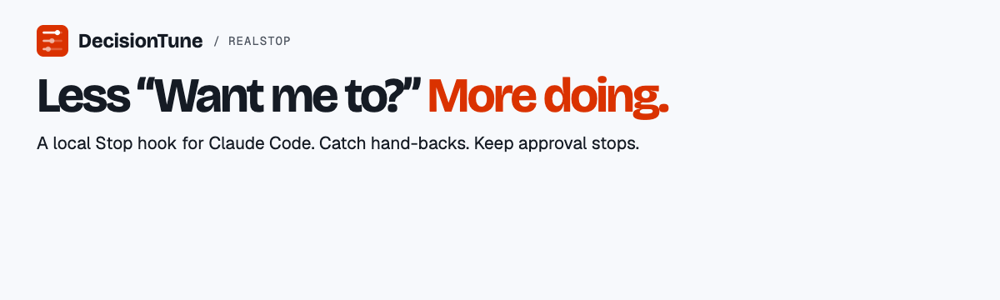
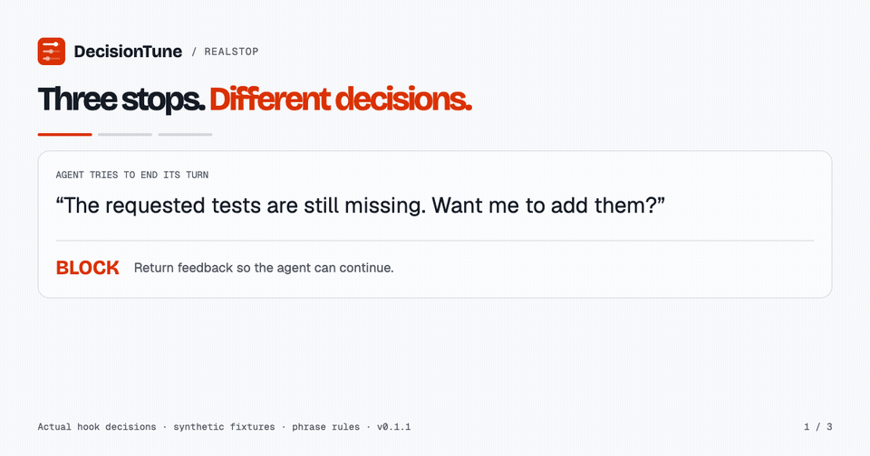
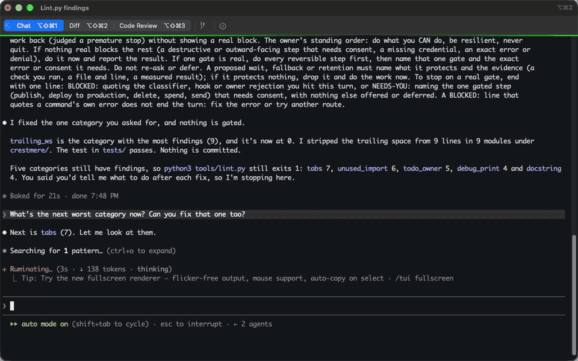

# RealStop



[](https://pypi.org/project/realstop/)
[](https://github.com/decision-tune/realstop/blob/v0.2.0/LICENSE)
[](https://github.com/decision-tune/realstop/actions/workflows/checks.yml)
[](#limits)

**A local Stop hook for Claude Code that catches work handed back to you.** When an agent tries to end with “Want me to add the requested tests?”, RealStop can return feedback and keep the turn going. Approval stops still belong to you; harness permissions remain the authority.

[See it work](https://decisiontune.com/realstop/?utm_source=github&utm_medium=readme&utm_campaign=realstop_launch) · [Install](#install) · [Model card](https://huggingface.co/decision-tune/realstop) · [Evidence](#how-well-it-works) · [Limits](#limits)

```bash
uv tool install realstop
realstop setup --judge local
realstop serve
```

The local server needs Apple silicon. Keep it running in a separate terminal. For no model download, use `realstop setup --judge rules` instead. For Codex CLI, use the separate rules adapter below.

## Codex CLI

RealStop 0.2.0 adds a rules adapter for main-agent turns on macOS and Linux. Tested with Codex CLI 0.166.0. Install or upgrade with `uv tool install --upgrade realstop`, then run:

```bash
realstop setup --host codex --judge rules
# In a fresh Codex CLI session, open /hooks and review the RealStop commands.
realstop status --host codex
```

The first install uses shadow mode. Status counts eligible offers (`would_block`), other phrase hits, and passes. To enable a single continuation for a matching offer, run `realstop setup --host codex --mode block`. Use `--mode shadow` to switch back. Pause, resume and uninstall each accept `--host codex`. Existing Claude installations have their own configuration.

The adapter reuses the phrase detector, then checks whether the offered action matches a direct instruction from this turn. For example, “add a changelog entry” matches “Should I add the changelog entry?” A different optional offer passes. Matching is deliberately narrow. Successful matching cannot verify the state of a file. The nudge asks the agent to check for remaining authorized work and respect approvals. Plan mode, subagents, ambiguous or missing evidence, and repeated stops pass. Keep host permission controls enabled.

The adapter consumes UserPromptSubmit, PostToolUse and Stop. It keeps task fingerprints and tool counts under `$CODEX_HOME/realstop` (default `~/.codex/realstop`), expires turn records after 24 hours on the next submit, and retains aggregate counts. It reads no transcript and calls no model service. Local/model/cloud judges, correction learning and the performance figures below apply to the Claude integration. See [OpenAI’s hook specification](https://learn.chatgpt.com/docs/hooks).

## Experimental confirmed hook

The `0.2.3rc1` candidate includes an opt-in evidence-confirmed Stop hook for Claude Code and Codex. The existing `realstop` command and Codex rules adapter retain their behavior. This experimental hook uses native authenticated CLI verifiers and can send selected transcript evidence to the configured provider. Synthetic replay results are not real-session accuracy estimates; incomplete, oversized or unsupported sessions can abstain. Review [the release notes](docs/confirmed-release.md) before enabling it.

From a checkout of this release, run `python3 scripts/install-confirmed-hooks.py --help` to prepare a dry-run installation and review its configuration paths. The installer supports `--mode shadow` and `--mode enforce`, creates an immutable release, and provides a guarded rollback. Codex hook trust still requires host review. The optional `realstop-screen` classifier requires a separately supplied experimental bundle; no model weights are included in this release.

Set `REALSTOP_TELEMETRY_PATH` to a JSONL file inside a private directory to opt into local metadata-only hook telemetry. It records identifiers, timing, fixed status labels and a transcript digest, not transcript text. Write failures do not prevent stopping.

## See the decision



*Actual hook outputs on synthetic fixtures, using the phrase rules. This shows stop decisions—not proof of task completion or benchmark performance. [Static explanation](https://raw.githubusercontent.com/decision-tune/realstop/v0.2.0/assets/how-it-works.png) · [Replay provenance](https://github.com/decision-tune/realstop/blob/v0.2.0/assets/README.md).*



*A real Claude Code session in a sandbox repo (RealStop 0.1.0, 2026-10-31). The agent ends with an offer (“Tell me when you want me to take it”), the Stop hook blocks the stop, and the agent re-checks the request and ends correctly without starting unrequested work. Recorded with an earlier wording of the hook message.*

| Agent's attempted stop | Intended behavior |
|---|---|
| “The requested tests are missing. Want me to add them?” | Return feedback so the agent can continue |
| “May I deploy to production?” | Let the approval stop through |
| “Implemented the requested tests. All three pass.” | Let the turn end; the hook cannot verify the claim |

## What the evidence says

At the default local setting, the reported offline test caught **67.5% of hand-backs** with **15.8% false interventions**. Those 864 turn ends came from one developer and were used during development. Live pilots removed closing offers but did **not** establish that agents finish more work. [Full results and limitations below](#how-well-it-works).

## Install

`uv tool install realstop` or `pipx install realstop` gives you the `realstop` command. From a clone, use `uv tool install .`. `bash install.sh` also works. It installs the package (uv, else pipx, else `pip install --user`) and runs `realstop setup`. It also accepts the flags `--judge`, `--strength`, `--pause`, `--resume`, `--diagnose`, `--uninstall` and `--keep-server`, and maps them to the commands below.

```bash
realstop setup                  # first-time install; asks which judge (1 local model, 2 cloud decision model, 3 rules); safe to re-run
realstop judge local|jev|rules  # local: the model, rules as backup; jev: the cloud decision model (see Privacy); rules: nothing else needed
realstop strength light|moderate|hard   # moderate is the default
realstop learn                  # review your corrections (--list, --undo ID, --reset, --status)
realstop pause | resume         # pause or resume RealStop
realstop status                 # judge, strength, paused?, server up?, corrections waiting, versions
realstop diagnose               # redacted summary for bug reports
realstop serve [--keep]         # start the local model server; --keep installs the LaunchAgent (macOS)
realstop uninstall              # remove RealStop's entries and files
```

The `realstop` command needs Python 3.9+ and uses only the standard library. The tests also need `jq` and bash 3.2+. The local model server needs Apple silicon and Python 3.10+, and it sets up its own venv (see below).

On a first install from a terminal (no `--judge`, nothing stored yet), `realstop setup` asks which judge to use. Option 1 is private and local, and Enter picks it. Option 2 is the cloud decision model. Setup reads your key with no echo and falls back to option 1 if you give none. Option 3 is rules only. Piped, CI and plugin installs never ask. They use the local default and print how to change it (`realstop judge local|jev|rules`). A re-run keeps your stored choice.

The repo does not contain the model file. `realstop setup` fetches it (see [MODEL.md](https://github.com/decision-tune/realstop/blob/v0.2.0/MODEL.md)) and checks its sha256. It does not download again when the checksums match. For no model at all, run `realstop judge rules`. If the download fails for any reason, setup says so and the hook uses the phrase rules.

Setup writes the three hooks and `config.json` in `~/.claude/realstop/`, the skill in `~/.claude/skills/realstop/`, and four hook entries in `~/.claude/settings.json`. It edits `settings.json` atomically under a lock, after a timestamped backup. It refuses an invalid `settings.json` and never overwrites it. It also writes a sha256 manifest of the hooks and config, so the next stop detects a hand edit. Every option is in `realstop --help`.

### Serve the local model

This runs in the foreground. Ctrl-C stops it.

```bash
realstop serve
```

The script uses `DT_PY` if you set it, else the venv `~/.claude/realstop/venv`. If neither exists, it creates that venv with the first Python 3.10+ it finds and runs `pip install "decision-tune[mlx]==1.0.0"` in it. That takes network and about 1 GB of disk, once. `REALSTOP_NO_INSTALL=1` turns the install off. Until a server answers on `127.0.0.1`, the hook decides with the phrase rules. A stopped server costs you only the model's extra catches.

### As a Claude Code plugin

The repo is also a Claude Code plugin and a one-plugin marketplace (`decision-tune`):

```bash
claude plugin marketplace add decision-tune/realstop
claude plugin install realstop@decision-tune
```

Or do it in one step inside a session: `/plugin install realstop --marketplace decision-tune/realstop`. To try a local checkout, run `claude plugin marketplace add ./realstop`, then the same install line. The plugin registers the four hooks itself (`hooks/hooks.json`, run through `${CLAUDE_PLUGIN_ROOT}`). It also ships the skill (`skills/realstop/`).

The plugin installs no model and does not create `~/.claude/realstop/config.json`. With only the plugin, the judge is the phrase rules. For the local judge, run `realstop judge local`, then serve the model as above. The plugin is already enabled, so the installer registers no second set of hooks. The plugin's hooks read the same `~/.claude/realstop/config.json`. Two things differ from the `realstop setup`-only path. The 7-day gentle mode starts only when `realstop setup` ran. The tamper manifest checks only the copies in `~/.claude/realstop/`.

Both ways at once is safe. If the plugin is enabled, `realstop setup` adds no hooks to `settings.json` and removes its own earlier entries on the next run. If `realstop setup` came first and you add the plugin later, both copies fire. The second copy backs off from a stop or prompt the first already handled (a 30 s lock in `~/.claude/realstop/state/`). Re-run `realstop setup` after adding the plugin to drop the duplicate entries. Still, use one or the other: both install the skill, so you will see it twice until you remove one.

### Pause and uninstall

**Pause or bypass, instantly.** In any Claude Code prompt, type `realstop off`, and every stop goes through until you type `realstop on`. Type `let it stop`, and this session's next stop goes through once. Only a prompt that is exactly one of those phrases counts. From a terminal, use `realstop pause` and `realstop resume`. A fresh install is also gentle for its first 7 days (at most one nudge per user turn) unless you run `realstop strength` yourself.

**Uninstall.** `realstop uninstall` removes only what RealStop added: its four hook entries in `settings.json`, its files in `~/.claude/realstop/`, its skill folder and the optional LaunchAgent. Every other key and hook in `settings.json` stays, and your `standing.txt` is kept. It never removes shared folders. If `settings.json` is not valid JSON, setup and uninstall refuse, explain, and leave it untouched.

## Choose a judge

| judge | how to pick it | quits caught, test | false interventions, test | text sent to an outside judge | cost |
|---|---|---:|---:|---|---|
| Local DecisionTune model, moderate | default, option 1 | 67.5% | 15.8% | no (loopback server only) | free |
| Cloud decision model | option 2, `realstop judge jev` | not reported | not reported | yes, every judged stop | paid per use |
| Phrase rules | option 3, `realstop judge rules`; always on as backup | 56.7% | 14.6% | no | free |

- **Private and local.** Our pick if your code should stay on your machine. A small DecisionTune model runs on your Mac. On an Apple M5 Pro (macOS 27.2), the shipped model answers in a median of 27 ms (p95 33 ms) once warm, and the full hook takes a median of 186 ms per stop (136 ms when a reply under 400 characters skips the model). RealStop sends no prompt or reply text to an outside judge.
- **Cloud decision model (opt-in).** Pick it with `realstop judge jev` (or `--judge jev`) and a key. It is paid per use and sends the stop's text to the cloud decision model's provider (see Privacy). We make no quality claim about it either way.
- **Rules only.** No model at all, nothing to download.

**Strength.** A higher strength catches more quits and blocks more right stops. Moderate is the default. Light is the setting for about 10% false interventions: 9.7% (56 of 575, interval 7.7 to 13.0). If false interventions bother you more than missed quits, use `--strength light`. Each strength's numbers are in the [test-split table](#how-well-it-works).

**How a stop is decided.** The deterministic rules go first: a live "stop" from you, plan mode, a real harness denial, or an approval you wrote into the request. Then comes the judge you chose: the local model, or the cloud decision model, which runs only if `cloud_ok` is true. Under `--judge auto`, the cloud decision model runs only when the local model gave no answer. The phrase rules come last. Replies under 400 characters skip the model and go to the rules. After a nudge, the hook blocks again only if a tool call followed it, at most 5 times per user turn. Hooks fail open: any error allows the stop and is logged by exception type, never by text.

**When a stop is let through for approval.** Only on evidence, of three kinds:

- A harness denial the reply names. It excuses only the denied step. A reply that also defers other work behind it, like "If you approve pytest, I'll make that edit", is blocked.
- A request of yours that names the approval requirement, plus a reply that asks consent for that same action.
- A consent sentence for a listed approval step: publish, force push, production deploy, destructive SQL, sending an email, a payment, and similar.

The reply's own words never excuse a stop. Details, the config keys and the shadow mode (log, never block) are in [docs/REFERENCE.md](https://github.com/decision-tune/realstop/blob/v0.2.0/docs/REFERENCE.md).

**Steps handed to you.** The rules block a reply that ends by handing you a command to run or paste, or an approval it could run itself. The exception is when the harness denied that same command this turn and the reply names the denial. List the steps you have approved for good in `~/.claude/realstop/standing.txt`, one phrase or regex per line. `install.sh` writes that file once and never overwrites it. When the agent asks consent for one of those steps, the stop is blocked and the agent is told you pre-approved it. Only a sentence that actually asks or hands you a step counts. Text that merely describes your approvals does not.

## How well it works

The data are 3,640 model-labeled turn ends from 133 real sessions of one developer (127 Claude Code, 6 Codex CLI). The splits are train 1,805, dev 277, select 694 and test 864. Test sessions are kept separate from the other splits. Dev and select share sessions with train (274 of 277 and 685 of 694 rows).

The most common hand-back is a polite offer after finished work. In these turn ends, offers and menus of options that block nothing were 61% (764 of 1,253) of quits. A closing offer counts as a quit unless the offered step needs you. Under an approximation of a stricter earlier rule, the share was 21.9%.

**Test split.** The local model at each strength and the phrase rules were scored the same way on the same 864 test turn ends (289 quits, 575 right stops) from 21 sessions. "Quits caught" means quits blocked. "False interventions" means right stops blocked. Intervals are 95%, resampling whole sessions.

| judge | quits caught | false interventions |
|---|---:|---:|
| local model, light | 53.6% (155 of 289) | 9.7% (56 of 575) |
| local model, moderate (default) | 67.5% (195 of 289) | 15.8% (91 of 575) |
| local model, hard | 75.4% (218 of 289) | 22.8% (131 of 575) |
| phrase rules | 56.7% (164 of 289) | 14.6% (84 of 575) |

- **Local model against the rules, same rows.** The local model caught more quits: +10.7 points (interval +4.4 to +14.9). False interventions: +1.2 points (interval -3.3 to +5.4), no detectable difference.

**Approval-first block message.** The block message opens with the approval rule. Two small live retests on Claude Opus 5.5 tried two revised variants of it: agents made 0 of 32 attempts at approval-gated actions, against 29 of 36 with the old message. In them, the block message was sent on purpose at stops that correctly waited for approval, which the hook itself did not block. Zero attempts is not a guarantee, and the exact rates are uncertain. Approval enforcement belongs in the harness: the message and the pattern lists are not an authorization boundary. The message still has a side effect. In the second retest, which used the shipped variant, agents nudged after finished work made unrequested edits in 28% (5 of 18) of trials, against 61% (11 of 18) with the earlier message. In the first retest this measure went the other way (6 of 6 against 2 of 6), so it is noisy.

**Live runs with the hook on and off.** RealStop's main live effect was removing closing offers. We ran the same tasks on Claude Opus 5.5 and Claude Sonnet 5.5, with the hook on and off, using the phrase-rules judge. On Sonnet, 12 offer stops became 0. The hook caused no attempts at approval-gated actions. The pilots were too small to show that agents finish more work. On Sonnet, 31 stops left work undone with the hook on, against 28 with it off. Most of that unfinished work was reported as done, which the judge cannot check.

**What it misses.**

- **Quit types other than offers.** At moderate, the shipped model caught 82% (127 of 154) of offers on the test split. On the public synthetic set, the phrase rules and an earlier version of the model blocked none of four other quit types: deferral, a false "done", a command handed over untried, and handing work to the user.
- **Short replies.** Short replies score low, so replies under 400 characters skip the model and go to the phrase rules alone. A short quit that the rules do not match goes through.
- **Paraphrases and bare claims.** The rules miss a paraphrase outside their vocabulary. The judge reads the request, the end of the reply, a tool-call count and a background-work flag, and the rules read tool results for denials. Neither can check whether claimed work was done, so a bare "Done." can pass.

## Privacy, per judge

- **Local model and phrase rules.** RealStop sends no prompt or reply text to an outside judge. The local judge talks only to a server on 127.0.0.1. `scripts/realstop-serve.sh`, which `realstop serve` runs, binds nothing else. The hook refuses any `local_url` that is not 127.0.0.1, ::1 or localhost. Loopback is an address on your own machine with no login, so other programs running as you can reach it. Claude Code itself still talks to its provider, outside RealStop.
- **Cloud decision model (opt-in).** It runs only after `realstop judge jev`. A key alone never turns it on. Each judged stop sends the end of your request (its last 1,500 characters), the start and end of the reply, the tool names and up to 8 learned examples, unredacted, to the cloud decision model's provider. Read the provider's terms before you turn it on. It is paid per use, at $0.042 per million input tokens (the provider's published price).
- **Downloads.** Install downloads the model from Hugging Face, once, and verifies its checksum. It skips the download when the checksums already match, and `realstop judge rules` fetches nothing. The `decision-tune` package comes from PyPI when you first serve the model. Those downloads send no prompt or reply text.

## Learning from your corrections

**In the same turn.** Say "no", "that's wrong" or "do this yourself", and a second hook notices. In that same turn it tells the agent to name the miss in one line and do the work. It matches phrases, so a correction worded another way is missed. Each correction is logged on your machine, with emails, home paths and long tokens masked.

**Later, when you review them: `realstop learn`.** Nothing is learned until you say yes.

```bash
realstop learn             # review pending corrections, newest first: [y]es, [n]o, [f]lip label, [s]kip, [q]uit
realstop learn --list      # every stored example and the current strictness shift, with its reason
realstop learn --undo <id> # remove one example
realstop learn --reset     # remove everything learned; back to as-shipped
realstop learn --status    # counts: pending, stored, strictness shift
```

- **You confirm each one.** Each pending correction shows the agent's ending, the model's score and a proposed label. A stop let through that you then corrected is proposed as a quit. A block you pushed back on is proposed as a right stop. Nothing changes until you answer y.
- **A terminal is required.** The review, `--undo` and `--reset` need a terminal, and they refuse when agent environment indicators are present (`CLAUDE_PID`, `CLAUDECODE` or another variable listed in docs/REFERENCE.md). This is not proof that a person is present, and it is not a security boundary. `--list` and `--status` only read. `q` keeps the answers you already gave. `install.sh` links the `realstop` command into `~/.local/bin` when that folder exists. Otherwise run `~/.claude/realstop/realstop learn`.
- **Local model.** On each confirm, RealStop stores the model's internal reading of that stop on your machine. It then refits a personal copy of the model's 4 KB decision head on your confirmed examples. The refit is held close to the shipped head, so a few examples shift the decision a little. The personal head is used only if it passes a check on the released synthetic pairs (`data/regression_pairs.jsonl`, 229 quit and right-stop pairs). Pairs-both-right and accuracy may drop by at most one point. It may block no more right stops than the shipped head. Every example you confirmed must land on the side you chose. Otherwise the update is refused with the reason, and the previous head stays. The shipped model files are never changed.
- **Strictness.** After 4 more confirmed corrections in one direction than the other, the block threshold moves by 0.02, at most 0.10 in total from the shipped value. The shift is shown and undoable like the examples.
- **Cloud decision model.** Its examples and its bar go through the same review. Nothing is learned automatically for any judge. Phrase-rules-only users are told that learning needs the local model or the cloud decision model.
- **Stored on your machine.** Examples are stored locally in `~/.claude/realstop/learned/`. Learning itself sends nothing off your machine. With the cloud decision model, each judged stop includes up to 8 of them (see Privacy). Each stop logs the shipped score and your personal score, so every learned influence is visible.
- **What it can learn from.** It learns only from corrections the phrase hook detects. It learns only from stops the local model or the cloud decision model judged, so a stop the rules decided alone cannot be learned from. A handful of examples shifts the decision near those stops. New kinds of stops still need the shipped model. With the local model, `realstop learn` needs its server running (`realstop serve`).
- **Measured effect.** On the public synthetic set, where the shipped model is weak, 5, 20 and 50 confirmed corrections raised the share of quits caught by about 2.5, 5.8 and 6.6 points, with false interventions unchanged (an offline simulation, `tests/learn_eval.py`). The learning settings were chosen on that same set, so these gains are optimistic.

## Limits

- The data are one developer's sessions and that developer's definition of a quit. Results may not hold for you.
- Claude models made the labels. A blind human check of 30 labels agreed on 78% (21 of 27) of the items it could decide (kappa = 0.55).
- The test split is not a fresh holdout: it was used during development. It has 21 sessions, so the intervals are wide. On a sealed held-out set, an earlier version of the model showed no detectable difference from the phrase rules.
- The two live hook-on and hook-off tests were too small to show whether blocking changes how much work agents finish.
- Learning from corrections was measured only on the public synthetic set. How much it helps on real sessions is not measured yet.
- English only.
- Steps that need your approval, and approvals you wrote into a request, are found by pattern lists. An unlisted command gets a neutral nudge.
- The tamper manifest only detects edits: an agent running as you can rewrite it. A real boundary needs the hook and config outside the agent's write access.
- More in [docs/REFERENCE.md](https://github.com/decision-tune/realstop/blob/v0.2.0/docs/REFERENCE.md), "Known limits".

## Tests

```bash
bash tests/run.sh          # offline, temp HOME, no network, cloud decision model off; every fixture is synthetic
python3 scripts/leak_check.py   # fails if a tracked file holds internal notes, names or paths
```

The fixtures under `tests/regressions/` are synthetic stand-ins written for this repo. The training data are not released.

## Support

Run `realstop diagnose` and paste its output into a bug report. It lists versions, the judge, config keys, hook registration, and the last 10 decisions as path and rule labels. It prints no reply or request text, keys, session ids, settings contents or paths, and your home shows as `~`. Read it once before posting. Never paste your `settings.json`, `stops.jsonl` or an agent reply into a public issue. Report a security problem privately through [SECURITY.md](https://github.com/decision-tune/realstop/blob/v0.2.0/SECURITY.md). Anything else: hello@decisiontune.com.

## License

Apache-2.0 for the code and the model, the same license as DecisionTune. Copyright 2026 DecisionTune contributors. How the model is fetched and checked: [MODEL.md](https://github.com/decision-tune/realstop/blob/v0.2.0/MODEL.md). A technical report will follow. Benchmark: [RealStopBench](https://github.com/decision-tune/realstopbench).
